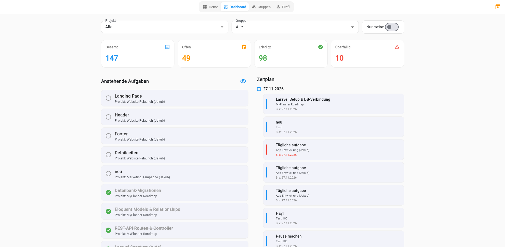
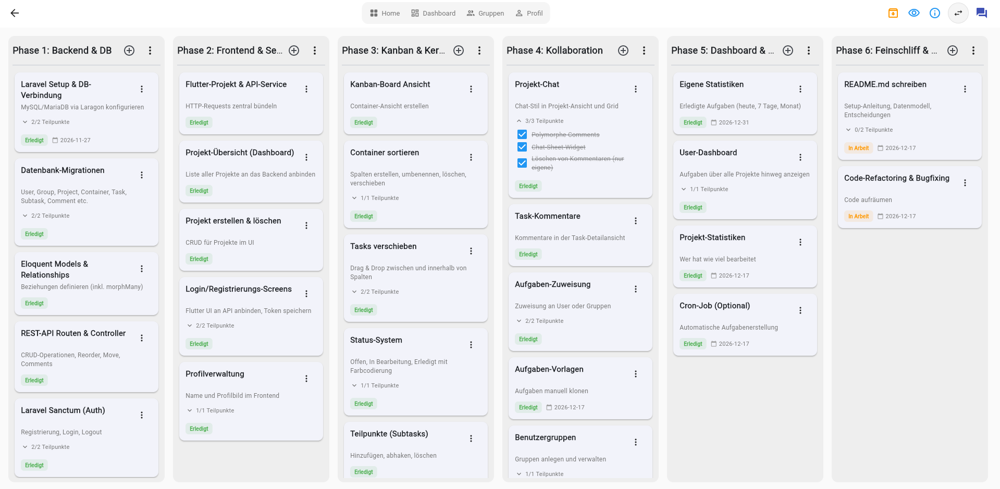
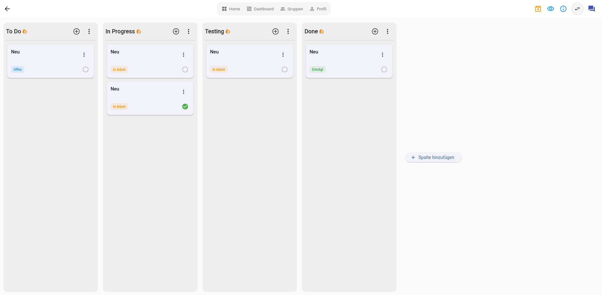
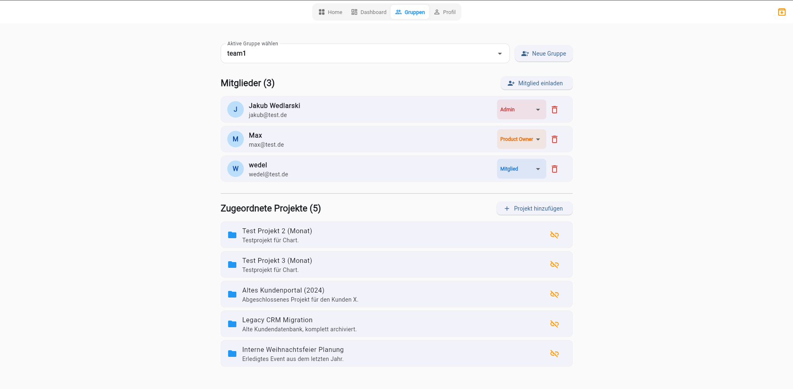
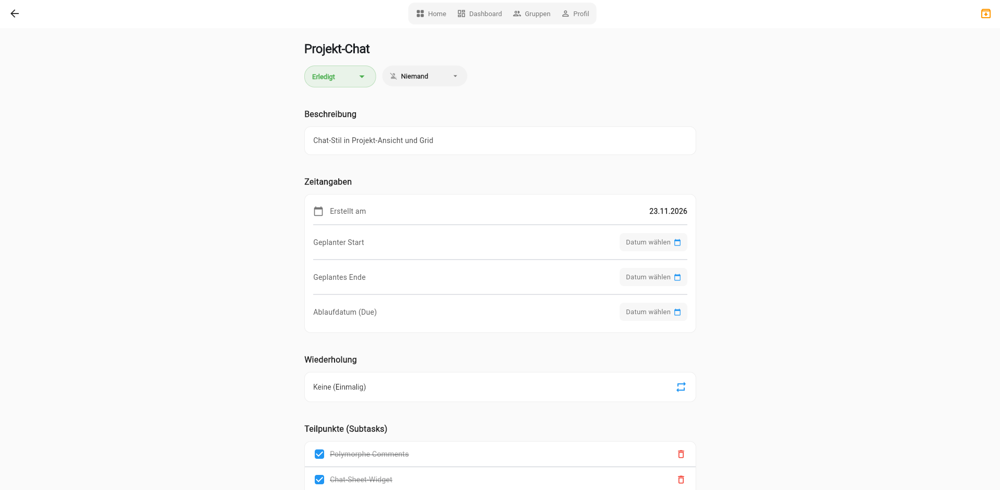
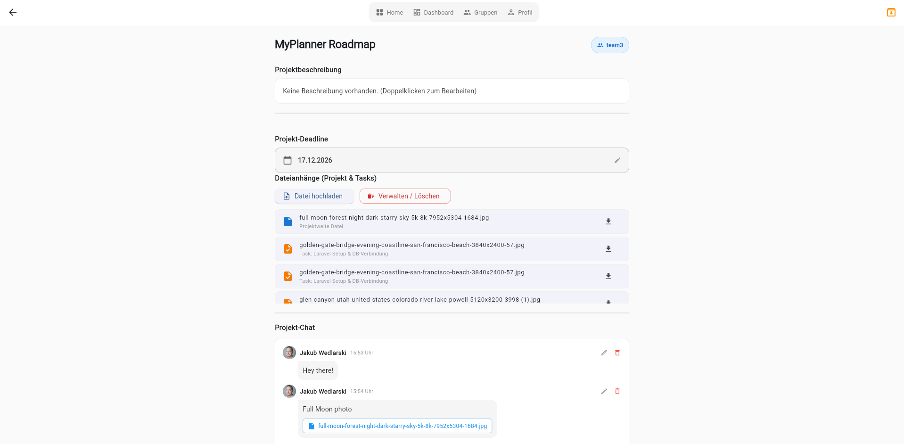
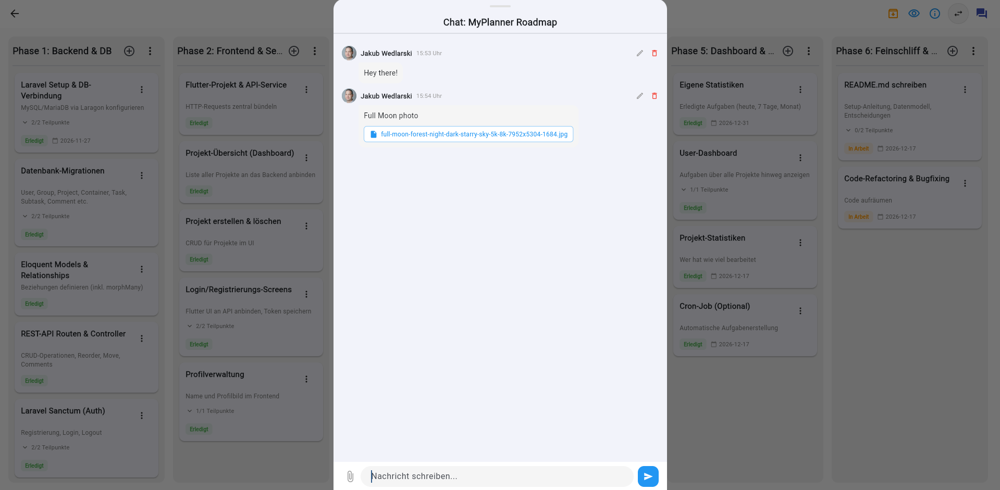
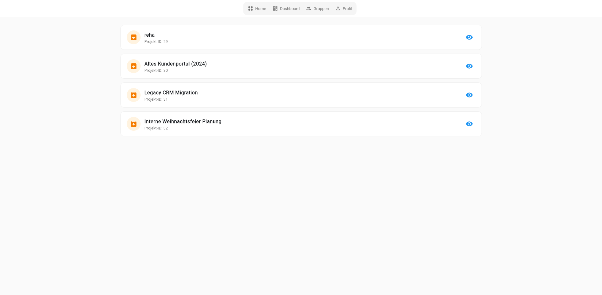

# 📋 MyPlanner - Kollaboratives Projekt- & Task-Management

MyPlanner ist eine moderne, webbasierte Anwendung zur Verwaltung von Projekten, Gruppen und Aufgaben. Es bietet ein flexibles Kanban-Board, rollenbasierte Zugriffskontrolle und ein umfangreiches Dashboard mit Echtzeit-Statistiken.

## ✨ Features im Überblick

### 🏢 Projekt- & Gruppenverwaltung
* **Gruppen:** Erstelle Teams und füge Mitglieder per E-Mail hinzu.
* **Rollenbasierte Zugriffskontrolle (RBAC):** 
  * `Admin`: Volle Kontrolle (Mitglieder verwalten, Projekte archivieren/zuweisen).
  * `Product Owner`: Darf Projekte verwalten, aber keine Mitglieder entfernen.
  * `Member`: Kann Aufgaben bearbeiten, aber keine strukturellen Änderungen vornehmen.
* **Projekt-Zuweisung:** Projekte können direkt aus dem Projekt-Grid oder der Gruppenverwaltung einer Gruppe zugewiesen werden.
* **Archivierung:** Abgeschlossene Projekte können ins Archiv verschoben werden, um die Hauptansicht übersichtlich zu halten.

### 📌 Kanban-Board (Task Management)
* **Drag & Drop:** Intuitive Verschiebung von Aufgaben und Spalten.
* **Force Status:** Spalten können so erzwungene Status (z.B. "In Arbeit", "Erledigt") haben. Wird eine Aufgabe in diese Spalte gezogen, ändert sich ihr Status automatisch.
* **"Bereit"-Häkchen:** Aufgaben können als "Bereit" markiert werden, um anzuzeigen, dass sie für die nächste Spalte (z.B. Testing) bereit sind.
* **Subtasks:** Teilpunkte können direkt auf der Kanban-Karte abgehakt oder im Detail-Screen verwaltet werden.
* **Wiederkehrende Aufgaben (Cronjob):** Aufgaben können täglich, wöchentlich (mit Wochentag) oder monatlich (mit Tag) automatisch neu erstellt werden – inklusive Catch-Up-Logik bei Server-Ausfällen.

### 📊 Dashboard & Statistiken
* **Echtzeit-Filter:** Filtere nach Projekten, Gruppen oder "Nur meine Aufgaben".
* **Visuelle Auswertung:** Interaktive Kreis- und Balkendiagramme (via `fl_chart`) zeigen den Fortschritt und erledigte Aufgaben im Zeitverlauf.
* **Timeline:** Eine Agenda-Ansicht zeigt anstehende Deadlines (heute und in der Zukunft) chronologisch an.

### 💬 Kommunikation & Dateien
* **Projekt- & Task-Chat:** Integrierter Chat für Kommentare und Diskussionen.
* **Dateianhänge:** Lade Dateien direkt an Projekte, Tasks oder in den Chat hoch.
* **Profilbilder:** Avatare können hochgeladen und im Chat angezeigt werden.

### 🎨 Modernes UI/UX
* **Inline-Editing:** Titel und Beschreibungen können per Doppelklick direkt bearbeitet werden.
* **Einheitliche Navigation:** Eine zentrale Navigationsleiste sorgt für Orientierung.
* **Deadline-Farbcodierung:** Deadlines färben sich grau, orange oder rot, je nach verbleibender Zeit.

---

## 🛠️ Technologie-Stack

**Frontend:**
* [Flutter](https://flutter.dev/) (Web & Mobile)
* `fl_chart` (für Diagramme)
* `http` & `file_picker` (Netzwerk & Dateiupload)

**Backend:**
* [Laravel](https://laravel.com/) (PHP Framework)
* Laravel Sanctum (API-Authentifizierung)
* MySQL (Datenbank)
* Nginx (Webserver)

---

## 🚀 Installation & Setup (Lokal)

### Voraussetzungen
* PHP >= 8.1
* Composer
* Node.js & NPM
* Flutter SDK
* MySQL Datenbank (z.B. via Laragon oder XAMPP)

### 1. Backend (Laravel)

# Repository klonen
git clone https://github.com/wedel88/myplanner
cd backend

# Abhängigkeiten installieren
composer install

# .env Datei kopieren und anpassen
cp .env.example .env
# Trage hier deine DB-Zugangsdaten ein (DB_DATABASE, DB_USERNAME, DB_PASSWORD)

# App-Key generieren
php artisan key:generate

# Datenbank migrieren
php artisan migrate

# Server starten
php artisan serve

### 2. Frontend(Flutter)
cd frontend

# Abhängigkeiten laden
flutter pub get

# App starten (im Chrome Browser)
flutter run -d chrome

### 3. Cronjob

Damit wiederkehrende Aufgaben automatisch erstellt werden, muss der Laravel Scheduler eingerichtet sein.

Unter Windows (Laragon/XAMPP):
Erstelle eine cron.bat Datei im Laravel-Projektordner:

@echo off
cd C:\pfad\zu\deinem\projekt
C:\pfad\zu\php\php.exe artisan schedule:run >> NUL 2>&1

Erstelle eine Aufgabe im Windows Task Scheduler, die diese .bat-Datei jede Minute ausführt.

Unter Linux (Nginx/Apache):
Füge diesen Eintrag zum Crontab hinzu (crontab -e):

* * * * * cd /var/www/dein-projekt && php artisan schedule:run >> /dev/null 2>&1

## 📸 Screenshots & Eindrücke

Hier sind einige Einblicke in die Benutzeroberfläche von MyPlanner. 

### 📊 Dashboard & Statistiken
Die zentrale Übersicht mit Live-Statistiken, Filtermöglichkeiten nach Projekten/Gruppen und interaktiven Diagrammen zur Visualisierung des Fortschritts.

### 📌 Kanban-Board (Projekt-Detailansicht)
Das Herzstück der App: Ein flexibles Kanban-Board mit Drag & Drop, "Force Status"-Spalten (die den Status automatisch anpassen) und dem "Bereit"-Häkchen für den Workflow.

### 🗂️ Kanban-Spalten & Workflow
Detailansicht der Spalten mit den integrierten Status-Anzeigen und dem Force-Status-Modus.

### 🏢 Gruppen- & Mitgliederverwaltung
Einblick in die rollenbasierte Rechteverwaltung. Hier können Admins und Product Owner neue Mitglieder einladen, Rollen ändern und Projekte zur Gruppe hinzufügen.

### 📝 Task-Detailansicht (Inline-Editing)
Modernes Design mit "Inline-Editing" (Doppelklick zum Bearbeiten), flexibler Datumsauswahl, Subtask-Verwaltung und Dateianhängen.

### 💬 Projekt-Info & Chat
Die Projekt-Info-Seite mit Upload-Funktion für Dateien und dem integrierten Projekt-Chat für die direkte Kommunikation.

### 🗄️ Archivierte Projekte
Abgeschlossene Projekte verschwinden aus der Hauptansicht, bleiben aber im Archiv für die spätere Nachvollziehbarkeit erhalten.

🔒 Sicherheitskonzept
API-Absicherung: Alle Routen (außer Login/Registrierung) sind durch Laravel Sanctum (Bearer Token) geschützt.

Backend-Validierung: Jede Aktion (Task verschieben, Projekt archivieren, etc.) wird serverseitig auf Berechtigungen geprüft (z.B. "Darf dieser User das Projekt archivieren?").

XSS & CORS: Nginx und Laravel sind so konfiguriert, dass sie gängige Web-Angriffe abwehren.

👨‍💻 Autor
[Jakub Wedlarski]

GitHub: @wedel88

LinkedIn: https://github.com/wedel88/

📄 Lizenz
Dieses Projekt ist unter der MIT-Lizenz lizenziert. Weitere Details findest du in der [LICENSE] (LICENSE) Datei.

